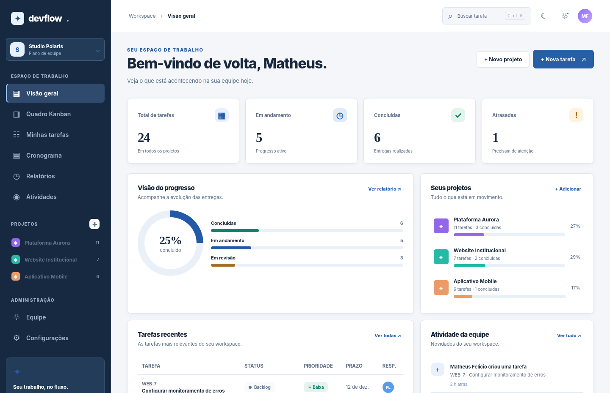
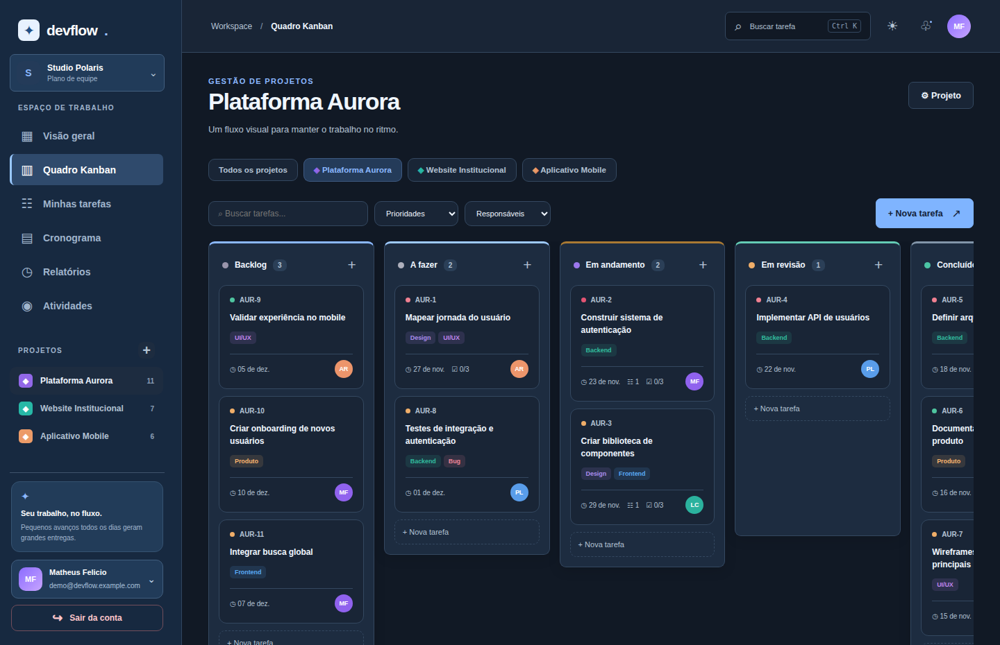
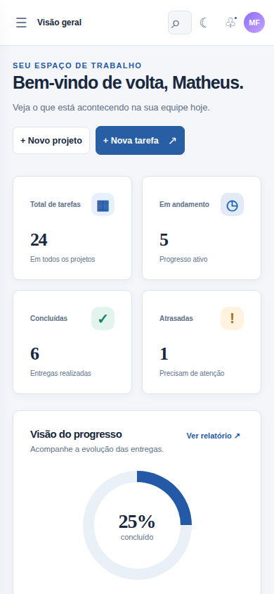

<div align="center">

# DevFlow

**Gerenciamento de projetos, tarefas e equipes em um só lugar.**


**[Perfil no GitHub](https://github.com/tteukkkk)** · **[Screenshots](#capturas-do-projeto)** · **[Como executar](#executar-localmente)**

<a href="previews/painel-claro.png"></a>

</div>

> **Status:** v1.1.2 · demonstração local; requer homologação para produção. Dados e contas de demonstração são fictícios. O repositório apresenta um aplicativo local, não um serviço publicado na internet.

## Capturas do projeto

| Funcionalidade | Versão mobile |
| :---: | :---: |
|  |  |

As demais telas (landing page, painel, relatórios, configurações e outras) estão em [`previews/`](previews/).

## Sobre o projeto

Uma aplicação **Full Stack** de gestão de projetos para equipes. Design minimalista, roxo como cor complementar, modo claro/escuro, Kanban, tarefas, histórico, relatórios e colaboração em tempo real.

> **Estado:** versão 1.1.2 para demonstração e portfólio. O código é funcional e foi testado localmente. **Não é um SaaS validado para produção comercial** sem as etapas descritas em `docs/PRODUCAO.md`.

## Principais recursos

- **Workspaces multiempresa** com isolamento de dados entre equipes.
- **Acesso protegido:** cadastro, login, senha Argon2, sessão assinada com cookie HttpOnly, proteção CSRF nas operações autenticadas e barreira inicial contra tentativas repetidas de senha.
- **Permissões:** proprietário, administrador, membro e visualizador.
- **Projetos:** nome, identificador, descrição, cor e arquivamento.
- **Kanban:** backlog, a fazer, em andamento, revisão e concluído; arrastar e soltar no desktop, edição de status acessível no celular.
- **Tarefas:** responsável, prioridade, prazo, estimativa, etiquetas, descrição, progresso de checklist e versão contra edição desatualizada.
- **Comunicação:** comentários, notificações dentro do app, atividades e eventos WebSocket para atualizações colaborativas de tarefas.
- **Equipe:** convites por link com expiração de sete dias e verificação do e-mail, papéis e membros.
- **Visualizações:** painel de resumo, Kanban, minhas tarefas, cronograma, relatórios e atividades.
- **GitHub:** conectar um repositório por projeto, listar issues abertas e importar uma issue como tarefa **uma única vez**. Integração de consulta/importação, não sincronização bidirecional.
- **Dados:** exportação CSV com proteção contra injeção de fórmulas de planilha.
- **Interface:** responsividade, alternância claro/escuro persistida no navegador, foco visível e preferência por movimento reduzido.


## Abrir com dois cliques no Windows (v1.1.2)

1. Extraia **toda** a pasta `DevFlow` do arquivo ZIP.
2. Tenha **Python 3.12 ou superior** instalado (com `py` ou `python` disponível no terminal).
3. Execute **`ABRIR_DEVFLOW.bat`** na pasta `DevFlow`.
4. Na primeira execução, o iniciador cria `.venv`, instala as bibliotecas (precisa de internet), gera `.env` com chave aleatória e cria um banco **somente se ainda não existir**.
5. O navegador abrirá automaticamente em `http://127.0.0.1:8010/entrar` assim que o servidor estiver pronto. Mantenha a janela do servidor aberta enquanto usa a aplicação.

**Conta fictícia inicial:** `demo@devflow.example.com` / `DemoSeguro#2026`. Caso já exista um banco, o iniciador **não altera usuários nem senhas**; utilize a conta desse banco.

Para fechar o servidor, pressione `Ctrl+C` na janela do iniciador. Se a porta `8010` já estiver ocupada por outro processo, feche-o antes. O iniciador não serve para implantação pública em produção.

## Executar localmente

Requer **Python 3.12 ou superior**, um navegador moderno e terminal.

```bash
# Na pasta DevFlow
python -m venv .venv
```

Ative o ambiente:

```powershell
# Windows / PowerShell
.venv\Scripts\Activate.ps1
```

```bash
# Linux / macOS
source .venv/bin/activate
```

Instale as dependências:

```bash
python -m pip install -r requirements.txt
```

Crie um arquivo `.env` com base em `.env.example` e configure `DEVFLOW_SECRET_KEY` com uma chave aleatória longa. Para gerar uma:

```bash
python -c "import secrets; print(secrets.token_urlsafe(48))"
```

Para inserir o ambiente fictício de demonstração:

```bash
python scripts/seed_demo.py
```

Execute:

```bash
python manage.py
```

Abra **http://127.0.0.1:8010/entrar** para fazer login ou **http://127.0.0.1:8010** para acessar a página inicial.

### Conta de demonstração **somente local**

- E-mail: `demo@devflow.example.com`
- Senha: `DemoSeguro#2026`

Os endereços `@devflow.example.com` são fictícios; não recebem mensagens. O script de exemplo não sobrescreve usuários já criados. **Não execute o seed de demonstração em produção e não publique o banco de dados gerado.**

## Testes

```bash
python -m pytest -q
```

A suíte cobre autenticação, controle de permissões, separação entre empresas, CSRF, tarefas, versionamento de alterações, convites, comentários, checklists, notificações, exportação segura, GitHub e WebSockets.

## Estrutura

```text
DevFlow/
├── devflow/
│   ├── app.py             # API REST, autenticação, integrações e WebSocket
│   ├── models.py          # Entidades e relacionamentos SQLAlchemy
│   ├── db.py              # Banco e sessões
│   └── security.py        # Hash de senha, CSRF e validações
├── templates/             # Landing, login e shell do aplicativo
├── static/                # Estilos, scripts e favicon
├── scripts/               # Seed de demonstração e prévias
├── tests/                 # Testes de API e segurança
├── previews/              # Imagens de apresentação
├── docs/                  # Arquitetura, produção e próximos passos
├── Dockerfile
├── compose.yaml
├── .env.example
├── requirements.txt
└── manage.py
```

## Banco de dados e implantação

O padrão é **SQLite**, adequado para demonstração local. A aplicação também pode se conectar a PostgreSQL através de `DEVFLOW_DATABASE_URL`, instalando o driver indicado em `requirements-postgres.txt`. O esquema inicial é criado automaticamente para desenvolvimento; para operação comercial, implementar e auditar **migrações Alembic**, processos de backup, monitoramento e controle de concorrência real.

**GitHub Pages não executa o backend FastAPI.** Para mostrar a aplicação online, use infraestrutura que ofereça processos Python, HTTPS e banco persistente (por exemplo, uma hospedagem de aplicações em nuvem). O arquivo `compose.yaml` serve para testes locais, não como configuração pública pronta.

## Segurança e limitações honestas

O protótipo inclui medidas iniciais de segurança, mas ainda precisa de testes de carga, revisão externa, proteção contra abusos distribuídos, infraestrutura de e-mails, logs estruturados e tratamento LGPD antes de receber dados de clientes reais. O aplicativo **não** possui cobrança, arquivos anexos nem sincronização bidirecional com o GitHub nesta versão. Leia `docs/PRODUCAO.md` para o checklist.

## Autor

Projeto criado como parte do portfólio de **Matheus Macêdo Felicio** — Desenvolvedor Full Stack.


## Novidades da versão 1.1 — Conta e configurações

- Barra lateral reorganizada com acesso ao perfil, área informativa separada e botão de saída dedicado.
- Edição de nome, e-mail e cor do avatar (com senha atual e validação).
- Troca de senha protegida por senha atual e CSRF.
- Configurações de workspace preservadas para administradores, temas claro/escuro e exportação CSV.

Veja [Perfil e configurações](docs/PERFIL-E-CONFIGURACOES.md).
